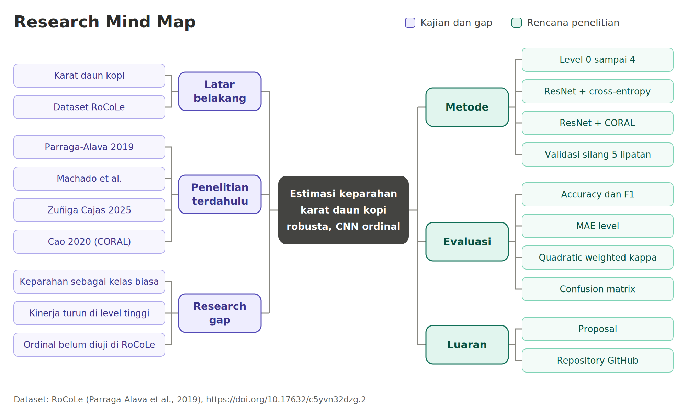

# Proposal Penelitian: Estimasi Tingkat Keparahan Penyakit Karat Daun Kopi Robusta Menggunakan Klasifikasi Ordinal Berbasis Convolutional Neural Network (CNN) pada Dataset RoCole

## 1. Latar Belakang
Karat daun kopi yang disebabkan oleh jamur *Hemileia vastatrix* termasuk penyakit yang paling merusak pada tanaman kopi, dan penilaian tingkat keparahannya yang akurat penting untuk menentukan strategi pengendalian (Zuniga Cajas et al., 2025). Pemeriksaan manual menuntut pengamatan visual daun secara dekat sehingga melelahkan dan rawan kesalahan, terutama pada lahan luas(Zuniga Cajas et. al., 2025). Karena itu, estimasi keparahan otomatis berbasis citra dan *Deep Learning* menjadi alternatif yang layak diteliti.

Dataset RoCole (Parraga-Alava et al., 2019) menyediakan 1.560 citra daun kopi robusta dengan label enam kelas: sehat, tungau laba - laba merah, dan karat level 1 sampai 4. Level karat ditentukan dari presentase luas daun yang terkena bercak menurut metode OIRSA. Machado et al. mengevaluasi enam CNN pada dataset ini, ResNet mencapai akurasi 95,19% untuk mengkalsifikasi biner, tetapi hanya 78,03% ketika membedakan daun sehat dan empat level karat, dengan kinerja yang turun tajam pada level 3 dan 4 yang jumlah citranya sedikit.

Level keparahan merupakan skala berurutan, sedangkan fungsi kerugian seperti *cross-entropy* tidak menangkap informasi urutan antarlabel (Cao et al., 2020). Cao et al. (2020) mengusulkan kerangka CORAL yang dapat memperluas CNN klasifikasi biasa menjadi regresi ordinal. Penelitian ini mengusulkan perbandingan CORAL dengan klasifikasi multikelas biasa pada estimasi keparahan karat di RoCole.

## 2. Rumusan Masalah

1. Bagaimana kinerja klasifikasi ordinal berbasis CNN (kerangka CORAL) dibandingkan klasifikasi multikelas biasa (*cross-entropy*) dalam mengestimasi tingkat keparahan karat daun kopi pada dataset RoCole
2. Bagaimana kinerja kedua pendekatan pada tingkat keparahan yang tinggi (level 3 dan 4) yang jumlah citranya sedikit?
3. Seberapa besar selisih level antara prediksi dan label sebenarnya pada kedua pendekatan?

## 3. Tujuan dan Batasan

**Tujuan:** (1) membandingkan kinerja CORAL dan *cross-entropy* pada backbone CNN yang sama (2) menganalisis kinerja pada level keparahan tinggi (3) mengukur besar kesalahan prediksi dalam satuan level.
**Batasa:**
- Data yang dipakai adalah citra sehat dan karat level 1 sampai 4 (1.393 citra) kelas tungau laba - laba merah dikeluarkan karena bukan bagian dari skala keparahan karat.
- Daun sehat diperlakukan sebagai level 0 (tidak ada bercak).
- Satu *backbone* CNN dengan dua cara pelatihan, tidak membandingkan banyak arsitektur.

## 4. Research Gap

## 5. Research Mind Map

## 6. Dataset Riset Kecil

| Item | Rencana |
|---|---|
| Nama repository | RoCoLe: A robusta coffee leaf images dataset |
| Alamat | https://data.mendeley.com/datasets/c5yvn32dzg/2 |
| DOI | 10.17632/c5yvn32dzg.2 (versi 2, 17 Mei 2019) |
| Lisensi | CC BY 4.0 (cantumkan atribusi) |
| Format | Citra JPEG; anotasi dalam JSON, CSV, COCO, VOC, dan XLSX (Parraga-Alava et al., 2019) |
| Cakupan yang dipakai | Sehat dan karat level 1 sampai 4: 1.393 citra (kelas tungau dikeluarkan) |

Distribusi kelas pada cakupan ini (dihitung dari jumlah citra yang dilaporkan Parraga-Alava et al., 2019):

| Level ordinal | Keterangan | Jumlah citra | Persentase |
|---|---|---|---|
| 0 | Sehat | 791 | 56,78% |
| 1 | Karat, luas daun terkena 1–5% | 344 | 24,69% |
| 2 | Karat, 6–20% | 166 | 11,92% |
| 3 | Karat, 21–50% | 62 | 4,45% |
| 4 | Karat, di atas 50% | 30 | 2,15% |

## 7. Metode Penelitian
1. **Persiapan Data:** Unduh dataset, pilih citra sehat dan karat level 1 dsampai 4, petakan label menjadi level 0 sampai 4, periksa ID tanaman pada anotasi.
2. **Pra-pemrosessan:** Ubah ukurn=an citra menjadi 224 x 224 (seperti Machado et al.), normalisasi dan augmentasi pada data latih saja (rotasi acak dan *flip*, seperti Machado et al).
3. **Model:** Satu *backbone* ResNet berbobot pralatih. Varian A memakai *cross-entropy* (multikelas biasa), varian B memakai CORAL (ordinal) (Cao et al., 2020).
4. **Penanganan ketimpangan:** Pembobotan kelas atau *oversampling* pada data latih auntuk kedua varian.
5. **Pelatihan dan validasi:** Validasi silang 5 lipatan terstratifikasi (dibagi per tanaman jika ID tersedia) hiperparameter sama untuk kedua varian.
6. **Evaluasi:** Metrik pada bagian 8, dilaporkan sebagai rata - rata dan simnpangan baku antarlipatan.
7. **Analisis:** Bandingkan kedua varian, khususnya pada level 3 dan 4, serta pola kesalahan pada *confusion matrix*.
   
## 8. Rencana Evaluation Matric

Metrik klasifikasi mengikuti Machado et al. (accuracy, precision, recall, F1) agar dapat dibandingkan, ditambah metrik yang memperhitungkan urutan level karena keparahan adalah skala ordinal.

| Kelompok | Metrik | Definisi singkat | Tujuan |
|---|---|---|---|
| Klasifikasi | Accuracy | citra benar / total citra | Gambaran umum kinerja |
| | Precision, Recall, F1 per kelas | TP/(TP+FP), TP/(TP+FN), 2PR/(P+R) | Kinerja tiap level, termasuk level 3 dan 4 |
| | Macro-F1 | rata-rata F1 antarkelas tanpa bobot | Menilai kelas minoritas secara adil |
| | Confusion matrix | prediksi vs label sebenarnya | Melihat level yang tertukar |
| Ordinal | MAE level | rata-rata \|level asli − level prediksi\| | Besar kesalahan dalam satuan level |
| | Adjacent accuracy | proporsi prediksi dengan selisih ≤ 1 level | Toleransi kesalahan satu level |
| | Quadratic weighted kappa | kesepakatan dengan bobot kuadrat selisih level | Menghukum kesalahan jauh lebih berat |
| Keandalan | Rata-rata ± simpangan baku | dari 5 lipatan validasi silang | Konsistensi hasil |

Bobot QWK untuk level i dan j dengan K = 5 level: w(i,j) = (i − j)² / (K − 1)².

## 9. Referensi

- Cao, W., Mirjalili, V., & Raschka, S. (2020). Rank consistent ordinal regression for neural networks with application to age estimation. *Pattern Recognition Letters, 140*, 325-331. https://doi.org/10.1016/j.patrec.2020.22.008
- Machado, T.V., Rodrigues, L. G. F., Travecolo, B. A. N., Costa, C. L., Lima, D. A., & Rodrigues Moreira, L. F. Evalution of convolutional neural networks for coffee leaf rust classification. *Workshop WCAMA, Sociedade Brasileira de Computacao*. https://sol.sbc.org.br/index.php/wcama/article/download/36078/35865
- Parrage-Alava, J., Cusme, K., Loor, A., & Santander, E. (2019). RoCole: A robusta coffee lear images dataset for evaluation of machine learning based methods in plant diseases recognition. *Data in Brief, 25*, 104414. https://doi.org/10.1016/j.dib.2019.104414
- Zuniga Cajas, J. J., Pena Ramos, O. D., Lasso, E., Avelino, J., Corrales, J.C., & Figueroa, C. (2025). Estimating the severity of coffee leaf trust using deep learning and image processing. *Inteligencia Artifical, 28*(76), 200-222. https://doi.org/10.4114/intartif.vol28iss76pp200-222
