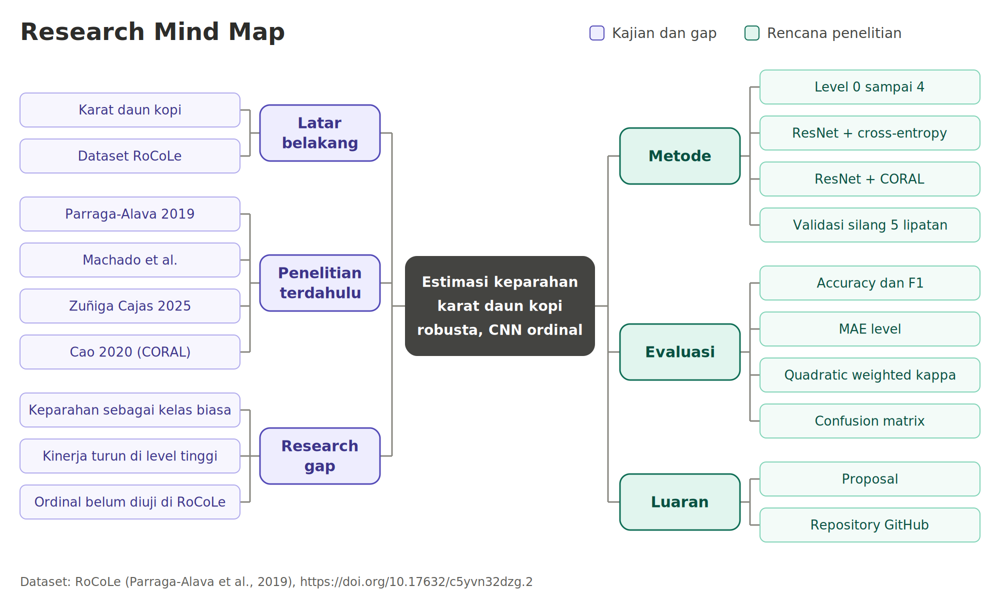
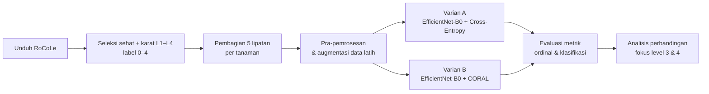

# Proposal Penelitian (UTS Riset Informatika)

**Estimasi Tingkat Keparahan Penyakit Karat Daun Kopi Robusta Menggunakan Klasifikasi Ordinal Berbasis Convolutional Neural Network (CNN) pada Dataset RoCoLe**

Nama         : Defina Aulia Salsabila

NPM          : 23081010280

Mata Kuliah  :  Riset Informatika

---

## BAB I PENDAHULUAN

### 1.1 Latar Belakang
Kopi merupakan komoditas perkebunan strategis Indonesia. Luas areal kopi nasional mencapai 1,274 juta hektare pada tahun 2024 dengan produksi 813,35 ribu ton, dan sekitar 98,74% areal dikelola oleh perkebunan rakyat [1]. Indonesia adalah produsen kopi terbesar keempat di dunia dengan kontribusi sekitar 7% terhadap produksi global, tetapi produktivitasnya masih berkisar 600–800 kg per hektare [2]. Kopi juga menyumbang devisa melalui ekspor sekitar 342 ribu ton pada Januari–September 2024 [3]. Produksi ini didominasi kopi Robusta, yang diproyeksikan oleh USDA menyumbang sekitar 88% produksi kopi Indonesia pada musim 2026/2027 [4]. Karena itu, keberlanjutan produksi kopi nasional sangat bergantung pada kesehatan tanaman Robusta.

Salah satu penyakit utama tanaman kopi adalah karat daun yang disebabkan oleh jamur *Hemileia vastatrix*. Kerugian global akibat penyakit ini diperkirakan mencapai 1–2 miliar dolar AS per tahun, dengan kehilangan hasil hingga 35% yang dapat berlanjut ke musim berikutnya [5]. Epidemi di Kolombia bahkan menurunkan produksi rata-rata 31% pada periode 2008–2011 dibandingkan tahun 2007 [6]. Kopi Robusta pun tidak sepenuhnya kebal, karena 16 dari 54 klon *C. canephora* yang diuji tergolong rentan [7]. Oleh karena itu, tingkat keparahan serangan perlu diketahui sejak dini agar pengendalian dapat disesuaikan dengan kondisi sebenarnya.

Saat ini keparahan penyakit umumnya dinilai secara visual sebagai persentase luas daun bergejala, lalu dikelompokkan ke dalam skala bertingkat [8]. Pada cara ini, pengamat merupakan sumber kesalahan terbesar, baik antarpengamat maupun pada pengamat yang sama. Pengamat juga cenderung menaksir terlalu tinggi pada keparahan rendah dan pada daun dengan banyak bercak kecil [8], padahal kondisi tersebut merupakan ciri karat tahap awal. Karena itu, diperlukan estimasi keparahan yang lebih objektif dan konsisten, yang tidak hanya mengenali ada atau tidaknya karat, tetapi juga mengestimasi tingkat keparahannya secara berurutan dari daun sehat hingga serangan berat.

*Deep learning* mampu mempelajari fitur langsung dari data tanpa perlu dirancang secara manual [9]. *Convolutional Neural Network* (CNN) mengekstraksi fitur secara bertahap, dari tepi dan warna hingga tekstur dan sebaran bercak, sesuai dengan ciri visual karat daun kopi. Namun, penerapan CNN pada penyakit tanaman masih lebih banyak berfokus pada identifikasi jenis penyakit dibandingkan penilaian tingkat keparahan [10]. Tingkat keparahan merupakan label ordinal, dan klasifikasi ordinal memanfaatkan urutan tersebut sehingga berpotensi menghasilkan prediksi yang lebih dekat dengan tingkat sebenarnya [11]. Sebaliknya, klasifikasi nominal dengan *cross-entropy* tidak menangkap urutan antarlabel [12]. Akibatnya, salah memprediksi serangan ringan sebagai sedang dianggap sama buruknya dengan salah memprediksinya sebagai berat. Kerangka ordinal untuk jaringan saraf tiruan telah dikembangkan untuk mengatasi hal ini [12]. Dalam penelitian ini, CNN berperan sebagai pengekstraksi fitur citra daun, sedangkan pendekatan ordinal menentukan tingkat keparahan dengan memperhatikan urutan antartingkat.

Data penelitian berasal dari dataset RoCoLe (*Robusta Coffee Leaf*), yang berisi 1.560 citra daun kopi Robusta dari 390 tanaman di Calceta, Ekuador. Citra diambil dengan kamera 5 MP dalam kondisi lapangan [13]. Dataset ini memuat 791 citra sehat, 167 citra serangan tungau merah, serta 344, 166, 62, dan 30 citra karat tingkat 1 sampai 4. Tingkat keparahan ditentukan dengan skala OIRSA (1–5%, 6–20%, 21–50%, dan >50% luas daun bergejala), dan anotasinya divalidasi oleh pakar [13]. RoCoLe relevan karena berisi kopi Robusta dengan label yang sudah berurutan, sekaligus menghadirkan ketidakseimbangan kelas yang nyata, yaitu 791 citra sehat berbanding hanya 30 citra tingkat 4. Kelas tungau merah merupakan serangan hama sehingga tidak termasuk skala keparahan karat.

Penelitian terdahulu menunjukkan celah yang sama. Esgario et al. [14] memperoleh akurasi 85,51% untuk estimasi lima tingkat keparahan daun kopi dengan ResNet50, tetapi keparahan diperlakukan sebagai kelas nominal. Chavarro et al. [15] memperoleh F1-score 94,70% dengan DenseNet201 pada gabungan lima dataset termasuk RoCoLe, namun hanya mendeteksi keberadaan karat. Zuñiga Cajas et al. [16] mencapai F1-score sekitar 0,80 untuk lima kelas keparahan pada kopi Caturra. Kinerja itu turun menjadi sekitar 0,52 saat diuji pada citra Robusta RoCoLe, dan penelitian tersebut tidak menggunakan pendekatan ordinal. Ardah et al. [17] memperoleh akurasi 92,51% pada RoCoLe dengan gabungan fitur GoogLeNet dan ResNet18 serta SVM, tetapi tingkat karat 1–4 tetap diperlakukan sebagai kelas biasa. Di luar kopi, Nigam et al. [18] mengestimasi empat tingkat keparahan karat gandum dengan EfficientNet-B0 dan CBAM (akurasi 96,68%), sedangkan Verbesselt et al. [19] menunjukkan bahwa CNN regresi ordinal efektif mengukur tingkat tekanan gulma (konsistensi peringkat, korelasi Spearman 0,87). Di Indonesia, penelitian citra daun kopi oleh Puspita et al. [20] serta Mutmainah dan Alamin [21] masih berfokus pada klasifikasi jenis penyakit dan tidak menilai keparahan.

Dengan demikian, penelitian keparahan karat yang ada masih memodelkan keparahan sebagai kelas biasa, termasuk yang menggunakan RoCoLe, padahal pendekatan ordinal telah terbukti bermanfaat pada masalah pertanian lain. Sejauh penelusuran literatur, belum ditemukan penelitian yang menerapkan klasifikasi ordinal berbasis CNN untuk mengestimasi keparahan karat daun kopi Robusta pada RoCoLe. Penelitian ini mengisi kesenjangan tersebut, dan apakah pendekatan ordinal lebih baik daripada klasifikasi nominal akan diuji melalui eksperimen.

### 1.2 Rumusan Masalah
Penilaian keparahan karat secara visual rentan terhadap subjektivitas, sedangkan penelitian berbasis citra masih berfokus pada jenis penyakit atau memperlakukan keparahan sebagai kelas nominal. Padahal, tingkat keparahan pada RoCoLe memiliki urutan yang jelas dan distribusi data yang sangat tidak seimbang. Rumusan masalah penelitian ini adalah:
1. Bagaimana menerapkan klasifikasi ordinal berbasis CNN untuk mengestimasi tingkat keparahan karat daun kopi Robusta pada dataset RoCoLe?
2. Bagaimana perbandingan kinerja klasifikasi ordinal dengan klasifikasi nominal pada arsitektur CNN, data, dan pra-pemrosesan yang sama, diukur dengan MAE dan QWK serta akurasi dan F1-score?
3. Bagaimana pengaruh ketidakseimbangan data antarkelas pada RoCoLe terhadap kemampuan model mengenali tingkat keparahan tinggi?

### 1.3 Tujuan Penelitian
1. Membangun model estimasi lima tingkat keparahan (sehat dan karat tingkat 1–4) menggunakan klasifikasi ordinal berbasis CNN, dengan CNN sebagai pengekstraksi fitur dan pendekatan ordinal sebagai penentu tingkat keparahan.
2. Membandingkan klasifikasi ordinal dan nominal dalam kondisi eksperimen yang setara (arsitektur, data, pembagian data, pra-pemrosesan, dan *seed* acak yang sama), dengan MAE dan QWK sebagai metrik utama serta akurasi, F1-score makro, dan *confusion matrix* sebagai pembanding.
3. Menganalisis kinerja model pada setiap tingkat keparahan, khususnya tingkat 3 dan 4 yang datanya paling sedikit, serta pengaruh penanganan ketidakseimbangan kelas terhadap kinerja tersebut.

### 1.4 Manfaat Penelitian
**Manfaat teoretis.** Penelitian ini menambah kajian estimasi tingkat keparahan penyakit tanaman, yang masih relatif sedikit dibandingkan identifikasi jenis penyakit. Penelitian ini memperlakukan keparahan sebagai label ordinal dan membandingkan pendekatan ordinal dengan nominal secara terkontrol, sehingga hasilnya menjadi bukti empiris tentang pengaruh pemodelan urutan label, bukan sekadar perbandingan arsitektur. Penggunaan MAE dan QWK juga menunjukkan cara evaluasi yang membedakan kesalahan yang meleset jauh dari kesalahan yang hanya bergeser satu tingkat.

**Manfaat praktis.**
1. Bagi pekebun dan perkebunan rakyat, penelitian ini menunjukkan sejauh mana keparahan karat dapat diestimasi otomatis dari citra kamera ponsel.
2. Bagi pengambilan keputusan, penelitian ini memberi gambaran potensi estimasi keparahan yang lebih objektif dan konsisten, sehingga pengendalian dapat disesuaikan dengan tingkat serangan.

### 1.5 Batasan Masalah
1. Penelitian berada pada ranah *machine learning* (*deep learning* dan *computer vision*), dengan fokus pada estimasi keparahan karat daun kopi oleh *Hemileia vastatrix*, bukan identifikasi jenis penyakit atau hama.
2. Objek penelitian adalah citra daun kopi Robusta dari RoCoLe yang berlabel sehat serta karat tingkat 1–4 menurut skala OIRSA (5 kelas berurutan). Kelas tungau merah dikeluarkan, dan tidak dilakukan pelabelan ulang.
3. Seluruh citra merupakan data sekunder dari Calceta, Ekuador (dipublikasikan 2019). Model tidak diuji pada citra perkebunan Indonesia atau lokasi lain, serta tidak menganalisis perkembangan penyakit, musim, atau cuaca.
4. Penelitian menggunakan CNN pralatih dengan *transfer learning* dan membandingkan dua skema penentuan keparahan, yaitu nominal dan ordinal, pada arsitektur yang sama (ditetapkan pada Bab III). Penelitian tidak mencari arsitektur CNN terbaik.
5. Keparahan diestimasi pada level citra (satu tingkat per citra daun), tanpa segmentasi bercak atau perhitungan luas bergejala pada level piksel.
6. Kinerja diukur dengan MAE dan QWK sebagai metrik utama, serta akurasi, F1-score makro, *confusion matrix*, dan kinerja per kelas sebagai pembanding. Pengujian dilakukan pada data uji yang terpisah dari data latih dan validasi, dengan pengulangan beberapa *seed* acak.
7. Ketidakseimbangan kelas ditangani pada tahap pelatihan (pembobotan kelas atau *oversampling* serta augmentasi data latih), tanpa data sintetis dari model generatif dan tanpa tambahan data dari sumber lain.

---

## BAB II TINJAUAN PUSTAKA

### 2.1 Penelitian Terdahulu
| No | Peneliti | Data | Metode | Hasil utama | Keterbatasan |
|---|---|---|---|---|---|
| 1 | Parraga-Alava et al. [13] | RoCoLe, 1.560 citra | Penyusunan dataset dan anotasi | Label sehat/tungau/karat level 1–4 (skala OIRSA), anotasi divalidasi pakar | Tidak ada model *baseline* untuk keparahan |
| 2 | Esgario et al. [14] | 1.685 citra daun kopi (Brasil) | CNN *multi-task*, ResNet50 | Akurasi 95,24% jenis cekaman; 85,51% untuk 5 tingkat keparahan | Keparahan diperlakukan sebagai kelas nominal |
| 3 | Zuñiga Cajas et al. [16] | Citra kopi Caturra, 5 kelas | CNN dan pengolahan citra | F1 ±0,80; turun ±0,52 saat diuji pada RoCoLe | Tidak memakai pendekatan ordinal |
| 4 | Machado et al. [22] | RoCoLe | 6 CNN (AlexNet, DenseNet, Inception, ResNet, SqueezeNet, VGG), 224×224, 5-fold CV | Biner 95,19%; 5 kelas 78,03% (ResNet). F1 level 3 = 21,30%, level 4 = 34,42% | Kinerja level tinggi sangat rendah, metrik hanya klasifikasi |
| 5 | Cao et al. [12] | Citra wajah (estimasi usia) | CORAL | Galat prediksi lebih kecil dibanding metode ordinal pembanding | Belum diuji pada penyakit tanaman |

### 2.2 Research Gap
| No | Gap | Dasar | Dijawab oleh |
|---|---|---|---|
| 1 | Keparahan karat diperlakukan sebagai kelas nominal dan dinilai dengan accuracy, precision, recall, F1, sehingga jarak kesalahan antartingkat tidak terukur | [14], [16], [17], [22] | RM 1 dan RM 2 |
| 2 | Kinerja turun tajam pada level keparahan tinggi akibat ketimpangan data (F1 level 3 = 21,30%, level 4 = 34,42%) | [22] | RM 3 |
| 3 | Pendekatan ordinal terbukti bermanfaat pada wajah dan gulma, tetapi penerapannya untuk keparahan karat kopi pada RoCoLe belum ditemukan | [12], [19] | RM 1 |

### 2.3 Landasan Teori

**a. Karat daun kopi dan skala keparahan.** Pada RoCoLe, keparahan ditentukan dengan skala OIRSA dari persentase luas daun yang tertutup bercak karat [13]. Karena level disusun dari rentang persentase yang naik, label membentuk urutan 0 < 1 < 2 < 3 < 4.

**b. CNN dan *transfer learning*.** CNN mengekstraksi fitur visual secara bertingkat melalui lapisan konvolusi. Dengan *transfer learning*, bobot hasil pralatih pada ImageNet dipakai sebagai titik awal sehingga model tetap dapat belajar dari dataset kecil seperti RoCoLe. **EfficientNet-B0** [23] dipilih karena menskalakan kedalaman, lebar, dan resolusi jaringan secara seimbang dengan jumlah parameter relatif kecil (±5,3 juta), sehingga cocok untuk data terbatas. Arsitektur ini juga telah dipakai untuk estimasi keparahan karat gandum [18].

**c. Klasifikasi nominal (*cross-entropy*).** Lapisan keluaran berisi K = 5 neuron dengan *softmax*, dan prediksi adalah kelas dengan probabilitas terbesar. Fungsi kerugian ini tidak memakai informasi urutan antarlabel [12].

### d. Klasifikasi ordinal dengan CORAL

**d. Klasifikasi ordinal dengan CORAL.** Label *y* ∈ {0, 1, …, K−1} diubah menjadi K−1 tugas biner *y*⁽ᵏ⁾ = **1**[*y* > *k*] untuk *k* = 0, 1, …, K−2. Semua tugas berbagi bobot **w** dan hanya berbeda bias *b*ₖ:

```text
P(y > k \mid \mathbf{x}) = \sigma\left(g(\mathbf{x})^\top \mathbf{w} + b_k\right)
```

Kerugian adalah jumlah *binary cross-entropy* dari $`K-1`$ tugas tersebut, dan prediksi level dihitung dengan

```text
\hat{y} = \sum_{k=0}^{K-2} \mathbf{1}\left[P(y > k \mid \mathbf{x}) > 0{,}5\right]
```

dengan $`\mathbf{1}[\cdot]`$ bernilai 1 jika kondisi di dalamnya benar dan 0 jika salah.

Karena bobot dipakai bersama, probabilitas yang dihasilkan selalu menurun seiring k (konsisten secara peringkat), sehingga prediksi tidak saling bertentangan antar-ambang [12].

**e. Ketimpangan kelas.** Level 4 hanya 2,15% data. Tanpa penanganan, model cenderung mengabaikan kelas minoritas. Penelitian ini memakai *oversampling* pada data latih (lihat 3.4) dan menguji pengaruhnya (lihat 3.5).

### 2.4 Research Mind Map


---

## BAB III METODOLOGI PENELITIAN

### 3.1 Alur Penelitian


### 3.2 Dataset Rencana Riset Kecil
| Item | Keterangan |
|---|---|
| Nama | RoCoLe: A robusta coffee leaf images dataset |
| Alamat | https://data.mendeley.com/datasets/c5yvn32dzg/2 |
| DOI | 10.17632/c5yvn32dzg.2 (versi 2, 17 Mei 2019) |
| Lisensi | CC BY 4.0 (wajib mencantumkan atribusi) |
| Format | Citra JPEG; anotasi JSON, CSV, COCO, VOC, XLSX |
| Sumber citra | 390 tanaman × 4 citra, Calceta (Ekuador), kondisi lapangan, kamera ponsel 5 MP |
| Cakupan dipakai | Sehat + karat level 1–4 = **1.393 citra** (kelas tungau, 167 citra, dikeluarkan) |

Distribusi kelas (dihitung dari jumlah citra yang dilaporkan pada [13]):

| Level | Keterangan | Jumlah | Persentase |
|---|---|---|---|
| 0 | Sehat | 791 | 56,78% |
| 1 | Karat, luas terkena 1–5% | 344 | 24,69% |
| 2 | Karat, 6–20% | 166 | 11,92% |
| 3 | Karat, 21–50% | 62 | 4,45% |
| 4 | Karat, > 50% | 30 | 2,15% |
| | **Total** | **1.393** | **100%** |

Rasio kelas terbesar terhadap terkecil ±26:1, sehingga penanganan ketimpangan menjadi bagian penting metode.

### 3.3 Persiapan Data dan Pra-pemrosesan
1. Unduh dataset, pilih citra sehat dan karat level 1–4, lalu petakan label menjadi level 0–4.
2. Identifikasi ID tanaman dari nama berkas atau anotasi. Keempat citra dari tanaman yang sama harus berada pada lipatan yang sama agar tidak terjadi kebocoran data.
3. Ubah ukuran citra menjadi 224 × 224 piksel dan normalisasi dengan rerata dan simpangan baku ImageNet.
4. Augmentasi hanya pada data latih: rotasi acak ±30°, *flip* horizontal, dan *flip* vertikal (mengikuti [22]).

### 3.4 Rancangan Model
| Komponen | Varian A (nominal) | Varian B (ordinal) |
|---|---|---|
| *Backbone* | EfficientNet-B0 pralatih ImageNet | EfficientNet-B0 pralatih ImageNet |
| Lapisan keluaran | 5 neuron + *softmax* | 1 bobot bersama + 4 bias (CORAL) |
| Fungsi kerugian | *Cross-entropy* | CORAL (jumlah BCE 4 tugas biner) |
| Prediksi | argmax probabilitas | jumlah P(y > k) > 0,5 |
| Penanganan ketimpangan | *Oversampling* data latih (*weighted random sampler*) | Sama dengan Varian A |

*Oversampling* dipakai untuk kedua varian, bukan pembobotan kelas, karena dapat diterapkan identik pada kedua fungsi kerugian sehingga perbandingan tetap adil.

### 3.5 Skenario Pelatihan dan Validasi
- **Validasi silang 5 lipatan terstratifikasi berbasis kelompok** (*stratified group k-fold*, kelompok = ID tanaman). Pada setiap lipatan, data uji terpisah dari data latih, dan data validasi untuk *early stopping* diambil dari bagian data latih.
- **Pengulangan:** seluruh skema 5 lipatan diulang dengan **3 *seed* acak**. Lipatan dan *seed* yang sama dipakai untuk kedua varian.
- **Skenario ketimpangan (menjawab RM 3):** setiap varian dilatih dengan dan tanpa *oversampling*, sehingga terdapat 4 konfigurasi.

| Konfigurasi | Pendekatan | *Oversampling* |
|---|---|---|
| A0 | Nominal | Tidak |
| A1 | Nominal | Ya |
| B0 | Ordinal (CORAL) | Tidak |
| B1 | Ordinal (CORAL) | Ya |

- Rencana awal hiperparameter (sama untuk semua konfigurasi, dapat disesuaikan saat eksperimen):

| Hiperparameter | Nilai rencana |
|---|---|
| Optimizer | Adam |
| *Learning rate* | 1 × 10⁻⁴ |
| *Batch size* | 32 |
| Epoch maksimum | 50, dengan *early stopping* (patience 10) pada MAE validasi |

### 3.6 Rencana Evaluation Metric
MAE dan QWK menjadi metrik utama karena keparahan berskala ordinal. Metrik klasifikasi tetap dilaporkan agar hasil dapat dibandingkan dengan penelitian terdahulu [22].

| Kelompok | Metrik | Definisi singkat | Tujuan |
|---|---|---|---|
| **Utama (ordinal)** | MAE level | (1/N) Σ \|yᵢ − ŷᵢ\| | Besar kesalahan dalam satuan level (RM 2) |
| | *Quadratic Weighted Kappa* (QWK) | kesepakatan berbobot kuadrat jarak level | Menghukum kesalahan jauh lebih berat (RM 2) |
| Pendukung ordinal | *Adjacent accuracy* | proporsi \|yᵢ − ŷᵢ\| ≤ 1 | Toleransi kesalahan satu level |
| Pembanding (klasifikasi) | Accuracy | citra benar / total citra | Pembanding dengan penelitian terdahulu |
| | Macro-F1 | rata-rata F1 antarkelas tanpa bobot | Menilai kelas minoritas secara adil (RM 2) |
| | Precision, Recall, F1 per kelas | TP/(TP+FP), TP/(TP+FN), 2PR/(P+R) | Kinerja tiap level, terutama level 3 dan 4 (RM 3) |
| | *Confusion matrix* | prediksi vs. label sebenarnya | Melihat level yang tertukar |
| Keandalan | Rata-rata ± simpangan baku | dari 5 lipatan × 3 *seed* | Konsistensi hasil |

Rumus QWK dengan K = 5 level, O = *confusion matrix* teramati, E = matriks harapan dari perkalian distribusi marginal:

```text
w_{ij} = \frac{(i-j)^2}{(K-1)^2}, \qquad \kappa = 1 - \frac{\sum_{i,j} w_{ij} O_{ij}}{\sum_{i,j} w_{ij} E_{ij}}
```

**Kriteria analisis:**
- **RM 2:** pendekatan ordinal dinilai lebih baik bila menghasilkan MAE lebih rendah dan QWK lebih tinggi tanpa penurunan Macro-F1 yang berarti. Pola kesalahan juga diperiksa pada *confusion matrix*, misalnya apakah kesalahan ordinal lebih banyak jatuh ke level yang bersebelahan.
- **RM 3:** recall dan F1 level 3–4 dibandingkan antara konfigurasi tanpa dan dengan *oversampling* (A0 vs. A1, B0 vs. B1).

---

## Daftar Pustaka

[1] Pusat Data dan Sistem Informasi Pertanian, *Outlook Komoditas Perkebunan Kopi Tahun 2026*. Jakarta, Indonesia: Sekretariat Jenderal, Kementerian Pertanian, 2026. [Daring]. Tersedia: https://satudata.pertanian.go.id/details/publikasi/996

[2] K. B. Andri, "Petani kopi Nusantara harus makin sejahtera," *ANTARA Megapolitan*, 29 Apr. 2026. [Daring]. Tersedia: https://megapolitan.antaranews.com/berita/526744/petani-kopi-nusantara-harus-makin-sejahtera

[3] "Tujuan utama ekspor kopi Indonesia, dari Amerika Serikat hingga negara tetangga," *Bisnis.com*, 15 Okt. 2024. [Daring]. Tersedia: https://ekonomi.bisnis.com/read/20241015/9/1807623/tujuan-utama-ekspor-kopi-indonesia-dari-amerika-serikat-hingga-negara-tetangga

[4] USDA Foreign Agricultural Service, "Indonesia: Coffee Annual," Global Agricultural Information Network (GAIN) Report, Jakarta, Indonesia, 2026. [Daring]. Tersedia: https://www.fas.usda.gov/data

[5] P. Talhinhas *et al.*, "The coffee leaf rust pathogen *Hemileia vastatrix*: one and a half centuries around the tropics," *Mol. Plant Pathol.*, vol. 18, no. 8, pp. 1039–1051, 2017, doi: 10.1111/mpp.12512.

[6] J. Avelino *et al.*, "The coffee rust crises in Colombia and Central America (2008–2013): impacts, plausible causes and proposed solutions," *Food Secur.*, vol. 7, no. 2, pp. 303–321, 2015, doi: 10.1007/s12571-015-0446-9.

[7] R. F. de Mendonça *et al.*, "Genótipos de café conilon e sua reação à ferrugem alaranjada," *Summa Phytopathol.*, vol. 45, no. 3, pp. 279–284, 2019, doi: 10.1590/0100-5405/183017.

[8] C. H. Bock, G. H. Poole, P. E. Parker, and T. R. Gottwald, "Plant disease severity estimated visually, by digital photography and image analysis, and by hyperspectral imaging," *Crit. Rev. Plant Sci.*, vol. 29, no. 2, pp. 59–107, 2010, doi: 10.1080/07352681003617285.

[9] Y. LeCun, Y. Bengio, and G. Hinton, "Deep learning," *Nature*, vol. 521, no. 7553, pp. 436–444, 2015, doi: 10.1038/nature14539.

[10] T. Shi *et al.*, "Recent advances in plant disease severity assessment using convolutional neural networks," *Sci. Rep.*, vol. 13, art. no. 2336, 2023, doi: 10.1038/s41598-023-29230-7.

[11] P. A. Gutiérrez, M. Pérez-Ortiz, J. Sánchez-Monedero, F. Fernández-Navarro, and C. Hervás-Martínez, "Ordinal regression methods: survey and experimental study," *IEEE Trans. Knowl. Data Eng.*, vol. 28, no. 1, pp. 127–146, 2016, doi: 10.1109/TKDE.2015.2457911.

[12] W. Cao, V. Mirjalili, and S. Raschka, "Rank consistent ordinal regression for neural networks with application to age estimation," *Pattern Recognit. Lett.*, vol. 140, pp. 325–331, 2020, doi: 10.1016/j.patrec.2020.11.008.

[13] J. Parraga-Alava, K. Cusme, A. Loor, and E. Santander, "RoCoLe: A robusta coffee leaf images dataset for evaluation of machine learning based methods in plant diseases recognition," *Data in Brief*, vol. 25, art. no. 104414, 2019, doi: 10.1016/j.dib.2019.104414.

[14] J. G. M. Esgario, R. A. Krohling, and J. A. Ventura, "Deep learning for classification and severity estimation of coffee leaf biotic stress," *Comput. Electron. Agric.*, vol. 169, art. no. 105162, 2020, doi: 10.1016/j.compag.2019.105162.

[15] A. F. Chavarro, D. Renza, and D. M. Ballesteros, "Influence of hyperparameters in deep learning models for coffee rust detection," *Appl. Sci.*, vol. 13, no. 7, art. no. 4565, 2023, doi: 10.3390/app13074565.

[16] J. J. Zuñiga Cajas, O. D. Peña Ramos, E. Lasso, J. Avelino, J. C. Corrales, and C. Figueroa, "Estimating the severity of coffee leaf rust using deep learning and image processing," *Inteligencia Artificial*, vol. 28, no. 76, pp. 200–222, 2025, doi: 10.4114/intartif.vol28iss76pp200-222.

[17] H. Ardah, M. Alrahhal, W. M. Abd-Elhafiez, and D. Trabay, "Robust coffee plant disease classification using deep learning and advanced feature engineering techniques," *PeerJ Comput. Sci.*, vol. 11, art. no. e3386, 2025, doi: 10.7717/peerj-cs.3386.

[18] S. Nigam, R. Jain, V. K. Singh, A. K. Singh, and H. Krishna, "Automated severity level estimation of wheat rust using an EfficientNet-CBAM hybrid model," *Front. Plant Sci.*, vol. 16, art. no. 1540642, 2025, doi: 10.3389/fpls.2025.1540642.

[19] S. Verbesselt, R. Daems, A. Willekens, and J. Van Beek, "UAV based weed pressure detection through relative labelling," *Remote Sens.*, vol. 17, no. 20, art. no. 3434, 2025, doi: 10.3390/rs17203434.

[20] D. Puspita, I. R. Padya, Efan, and F. Putrawansyah, "Robusta coffee disease classification using optimized MobileNetV3 and DenseNet169," *Ingénierie des Systèmes d'Information*, vol. 30, no. 11, pp. 2917–2928, 2025, doi: 10.18280/isi.301110.

[21] S. Mutmainah and Z. Alamin, "Detection of coffee leaf diseases using deep learning to support digitalization and smart agriculture," *J. Tek. Inform. (JUTIF)*, vol. 7, no. 3, 2026, doi: 10.52436/1.jutif.2026.7.3.5338.

[22] T. V. Machado, L. G. F. Rodrigues, B. A. N. Travençolo, C. L. Costa, D. A. Lima, and L. F. Rodrigues Moreira, "Evaluation of convolutional neural networks for coffee leaf rust classification," in *Proc. XVI Workshop de Computação Aplicada à Gestão do Meio Ambiente e Recursos Naturais (WCAMA)*, Porto Alegre, Brazil: SBC, 2025, pp. 11–20, doi: 10.5753/wcama.2025.6650.

[23] M. Tan and Q. V. Le, "EfficientNet: Rethinking model scaling for convolutional neural networks," in *Proc. 36th Int. Conf. Mach. Learn. (ICML)*, PMLR, vol. 97, 2019, pp. 6105–6114.
